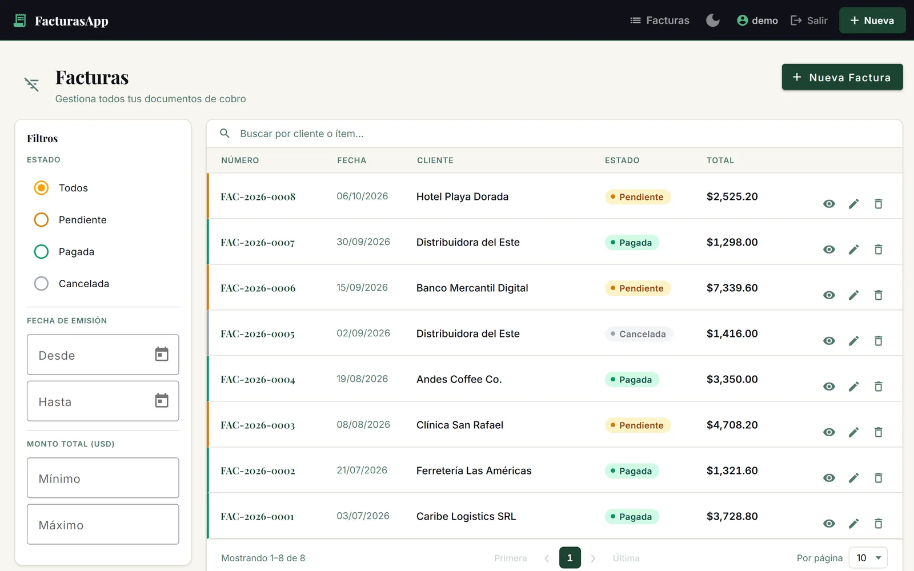
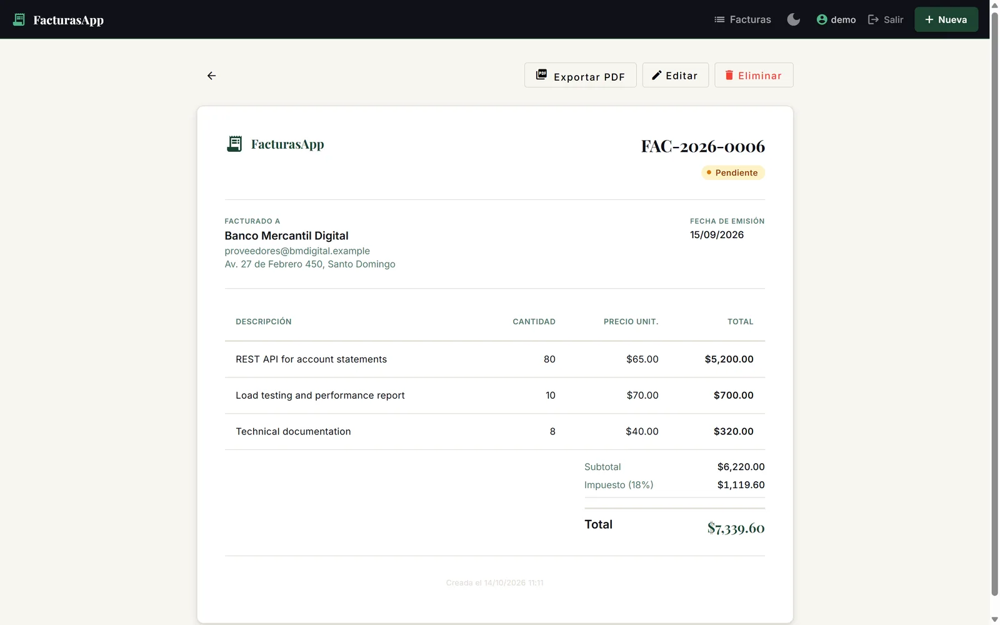
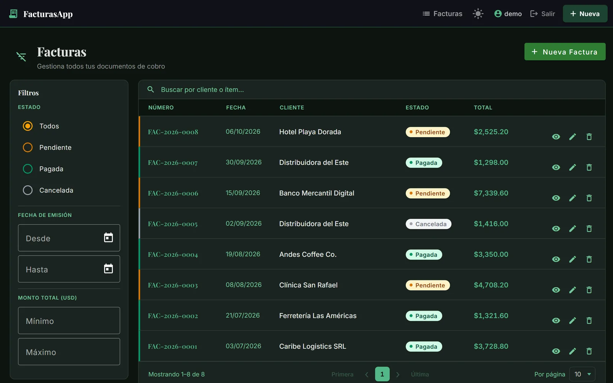

# FacturasApp — AI-assisted full-stack invoicing

A full-stack invoicing application built by directing [Claude Code](https://claude.com/claude-code): I defined the architecture rules and design constraints, designed custom agents for QA, security hardening and Angular code review, and orchestrated them across the project.

**Demo video:** see the FacturasApp card on [agustinestevez.vercel.app](https://agustinestevez.vercel.app/en/#projects)



| Invoice detail | Dark theme |
| --- | --- |
|  |  |

## Features

- Invoices with line items, statuses (`PENDING`, `PAID`, `CANCELLED`) and auto-generated numbers (`FAC-YYYY-NNNN`)
- Totals computed on the server with `BigDecimal` (subtotal, tax, total); the form previews them live
- List with search, status / date / amount filters and pagination
- PDF export of an invoice
- Light and dark themes
- Username/password accounts

## Stack

| Layer | Technology |
| --- | --- |
| Frontend | Angular 17, Angular Material, TypeScript |
| Backend | Spring Boot 3.4, Java 17, Spring Security, Spring Data JPA |
| Database | PostgreSQL (Supabase) |
| Tests | JUnit 5, Mockito, MockMvc, `@DataJpaTest`, H2 |

## Security

- JWT stored in an **HttpOnly, SameSite=Strict cookie** (never exposed to JavaScript)
- **CSRF protection** with a cookie-to-header token (`XSRF-TOKEN` / `X-XSRF-TOKEN`)
- **Per-IP rate limiting** with Bucket4j: 60 req/min on the API, 10 req/min on login and register
- **Security headers** (`X-Content-Type-Options`, `X-Frame-Options: DENY`, `Referrer-Policy`, …)
- Input validation and HTML stripping on user-supplied text
- No secrets in the repository: credentials come from environment variables or a git-ignored local file

## Tests

The backend has **89 tests**, all passing:

| Suite | Tests | Scope |
| --- | --- | --- |
| `InvoiceServiceImplTest` | 32 | Business rules, totals, numbering (unit, Mockito) |
| `InvoiceControllerTest` | 26 | Web layer with MockMvc: validation, status codes, payloads |
| `InvoiceIntegrationTest` | 12 | Full stack on H2: auth cookie + CSRF, CRUD, XSS stripping |
| `InvoiceRepositoryTest` | 9 | JPA queries with `@DataJpaTest` |
| `SecurityHeadersFilterTest` | 5 | Response headers |
| `RateLimitFilterTest` | 4 | Request limits per IP |
| `FacturasApplicationTests` | 1 | Context loads |

```bash
cd backend
mvn test
```

## Built with Claude Code

- **Project rules** in [`CLAUDE.md`](CLAUDE.md): layering, money handling, what the server must compute, schema policy.
- **Custom agents** in [`.claude/agents`](.claude/agents):
  - `qa-backend-engineer` — designs and runs backend tests
  - `security-engineer` — reviews and hardens the API
  - `angular-frontend-reviewer` — reviews Angular code against the project's conventions
- **MCP integrations:** Supabase (database) and Playwright (browser checks).
- **Custom MCP server** in TypeScript ([`mcp-weather`](mcp-weather)): a standalone exercise exposing weather lookup and clothing suggestions as tools.
- **Hooks and skills:** a file-blocking `PreToolUse` hook ([`hooks`](hooks)) and installed skills.

## Running locally

Requirements: Java 17+, Maven 3.6+, Node.js 18+ and Angular CLI 17.

### With Supabase

1. Run [`database/schema.sql`](database/schema.sql) in the Supabase SQL editor (optionally [`database/seed.sql`](database/seed.sql)).
2. Configure the backend, either with environment variables (`DB_USERNAME`, `DB_PASSWORD`, `JWT_SECRET`) or by copying [`backend/application-local.properties.example`](backend/application-local.properties.example) to `backend/application-local.properties` (git-ignored) and filling it in. Generate the JWT secret with `openssl rand -base64 64`.
3. Start both apps:

```bash
cd backend && mvn spring-boot:run      # http://localhost:8082
cd frontend && npm install && ng serve # http://localhost:4200
```

### Demo mode (no database setup)

Runs the backend on an in-memory H2 database and loads sample invoices. Nothing is persisted.

```bash
cd backend
mvn spring-boot:run -Dspring-boot.run.useTestClasspath=true \
  "-Dspring-boot.run.arguments=--spring.datasource.url=jdbc:h2:mem:demo;DB_CLOSE_DELAY=-1 --spring.datasource.driver-class-name=org.h2.Driver --spring.datasource.username=sa --spring.datasource.password= --spring.jpa.hibernate.ddl-auto=create-drop --spring.jpa.database-platform=org.hibernate.dialect.H2Dialect --jwt.secret=$(openssl rand -base64 64 | tr -d '\r\n')"

# in another terminal, once the backend is up
bash scripts/seed-demo-data.sh
```

Then log in at http://localhost:4200 with the demo user defined in [`scripts/seed-demo-data.sh`](scripts/seed-demo-data.sh).

## API

| Method | Path | Description |
| --- | --- | --- |
| `POST` | `/auth/register` | Create an account |
| `POST` | `/auth/login` | Log in (sets the JWT cookie) |
| `GET` | `/auth/me` | Current user |
| `POST` | `/auth/logout` | Clear the session cookie |
| `GET` | `/api/v1/invoices` | List invoices (paged, filterable) |
| `GET` | `/api/v1/invoices/{id}` | Invoice detail |
| `POST` | `/api/v1/invoices` | Create an invoice |
| `PUT` | `/api/v1/invoices/{id}` | Update an invoice |
| `PATCH` | `/api/v1/invoices/{id}/status` | Change status |
| `DELETE` | `/api/v1/invoices/{id}` | Delete an invoice |
